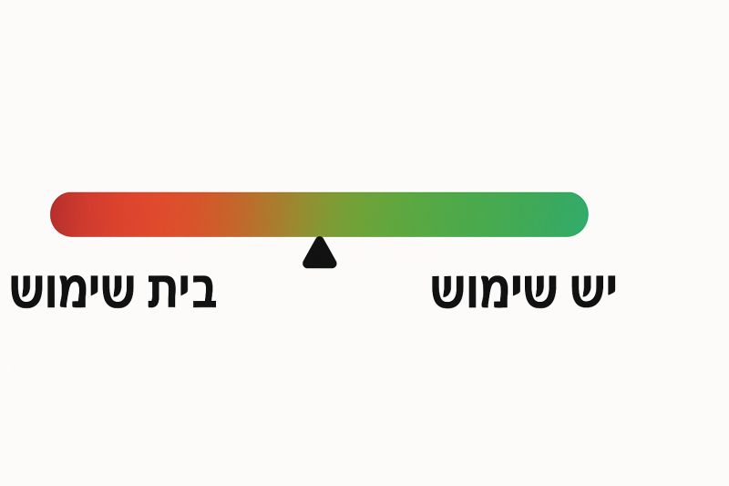

# גל ההכרזות ב-AI נהיה צונאמי.

גל ההכרזות ב-AI נהיה צונאמי.
כל יום יוצא פיצ'ר חדש, מרגש, מתקדם, ולפעמים גם... מיותר.
ראיתי השבוע את ההכרזה על MCP חדש שמתממשק ל-Jira ונוצר בקלות בתוך Docker.

זה נשמע עתידני וניכרת ההתרגשות (בקרב מפתחים, סליחה לכל מי שזה ג׳יבריש עבורו) אבל אחרי רבע שעה של התעסקות - הבנתי שזה פחות נוח מהפלאגין הפשוט שיש לי ב-VS Code שכבר עכשיו פותח לי ברנצ' ומעדכן את הטיקט ב-Jira בלחיצת כפתור.

אותו דבר עם ההכרזה המהפכנית שהיתה לOPEN AI עם היכולת של צ׳אט ג׳יפיטי "לראות". ניסיתי להבין מה עושים עם זה, אפילו שאלתי מסביב, ועד היום לא מצאתי שום שימוש אמיתי. זאת טכנולוגיה מטורפת, אבל לא שימושית.

דווקא היכולת הקולית כן שימושית אני מצאתי את עצמי משוחח איתו לא פעם. אם היא היתה מעט יותר טובה כנראה שהייתי מאמץ אותה יותר.

ואני יכול להמשיך עם עוד המון דוגמאות. כמה מכם חזרתם ליכולת יצירת תמונות של Chat GPT אחרי שירדה ההתלהבות הראשונית של תמונות דיסני שלכם ושל מפורסמים? 
כמה מכם משתמשים ביום יום שלכם ביכולת לשמוע פודקאסט שמקריין לכם מסמך משעמם עם Google Notebook LLM? אתם באמת מרגישים בהבדל כשמשתמשים ב-Custom GPT? אתם משתמשים בהם בכלל? או בניתוח מעמיק של נושא? או בסוכנים שגולשים עבורכם ברשת?

אז הנה רעיון:
במקום להתרגש אוטומטית, נמדוד כל כלי חדש לפי סקאלה פשוטה:
בית שימוש ← יש שימוש

כלומר, לא מה זה יודע לעשות, אלא מה זה יודע לעשות *עבורי*.

אם זה לא חוסך זמן, לא מקל על עבודה, ולא פותר כאב - זה אולי מגניב, אבל זה עדיין ״בית שימוש״. (מבלי לזלזל ביכולת הטכנולוגית חסרת התקדים והמהפכנית שכבודה במקומה). 

אז מה הפיצ'ר האחרון שיצא בכל חידושי ה-AI ובאמת היה לכם שימושי?

Original source: https://www.linkedin.com/posts/ofershap_%D7%92%D7%9C-%D7%94%D7%94%D7%9B%D7%A8%D7%96%D7%95%D7%AA-%D7%91-ai-%D7%A0%D7%94%D7%99%D7%94-%D7%A6%D7%95%D7%A0%D7%90%D7%9E%D7%99-%D7%9B%D7%9C-%D7%99%D7%95%D7%9D-%D7%99%D7%95%D7%A6%D7%90-activity-7322507416158330881-S0hF
Published: 2025-04-28T09:30:13.621000+03:00

## על עופר שפירא

אני עופר שפירא, מוביל צוות AI Engineering ובונה כלי קוד פתוח: כלי פיתוח, שרתי MCP, ספריות TypeScript ו-GitHub Actions. כאן אני כותב על AI, פיתוח וניהול צוותי הנדסה.

[GitHub projects](https://github.com/ofershap) | [LinkedIn](https://www.linkedin.com/in/ofershap/)

