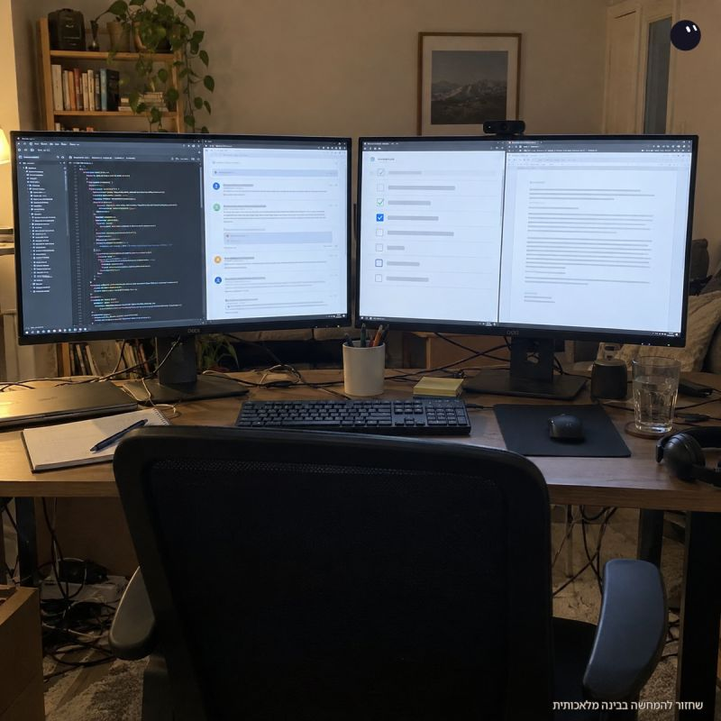

# פתאום קלטתי שבאותו רגע רצו אצלי ארבע שיחות עבודה עם בוטים:

פתאום קלטתי שבאותו רגע רצו אצלי ארבע שיחות עבודה עם בוטים:

אחת על PR שהצוות לא הסכים לגביו.
אחת על review לשינוי של מישהו אחר.
אחת על ההערות בקוד שלי.
ואחת על כיוון המוצר.

ארזתי את הרגע הזה למצגת שלי על Grok Bot שאני מעביר בעבודה. יש עבודה שצריכה חפירה בקוד, ויש עבודה שצריכה להחזיר לי החלטה קצרה. כשהן לא תלויות זו בזו, אני רוצה שיתקדמו במקביל. זאת הדרך שלי לפצל את העבודה בגרוק בוט.

אין עדיין Best Practice לגבי איך מחלקים את הבוטים בגרוק, וכל אחד בונה את זה כראות עינייו ועם חשש קל שהוא לא עושה את זה בצורה הנכונה ביותר.

גם אני עדיין מכוונן את החלוקה. בעיקר מי מחזיק מה, ואיך כל שיחה חוזרת אליי עם תוצאה במקום עם שאלה על השיחה האחרת.

דבר נוסף ששמתי לב אליו זה ה״רמאות״ - במקום שגרוק בוט יחסוך לי עבודה אני מוצא את עצמי עובד אפילו יותר כדי להשלים פערים גם בגרוק בוט בנוסף לסלאק. וגם ההודעות של גרוק בוט ארוכות כמו מגילה. גם בזה טיפלתי וביקשתי ממנו גם לצמצם תשובות (לקחתי את שיטת הסקיל של ״האדם הקדמון״ וביקשתי ממנו שיעשה גרסה ישראלית מקוצרת ושיענה לי ככה).

גם ביקשתי שאם אני לא עונה שלא יפציץ בהודעות, יש לו נטיה להמשיך לשלוח ולשלוח ולשלוח

אם לכם יש דרך שאתם ממליצים אני אשמח לשמוע עליה!

Original source: https://www.linkedin.com/feed/update/urn:li:share:7520735377570029568/
Published: 2026-10-27T08:37:00+02:00

## על עופר שפירא

אני עופר שפירא, מוביל צוות AI Engineering ובונה כלי קוד פתוח: כלי פיתוח, שרתי MCP, ספריות TypeScript ו-GitHub Actions. כאן אני כותב על AI, פיתוח וניהול צוותי הנדסה.

[GitHub projects](https://github.com/ofershap) | [LinkedIn](https://www.linkedin.com/in/ofershap/)

